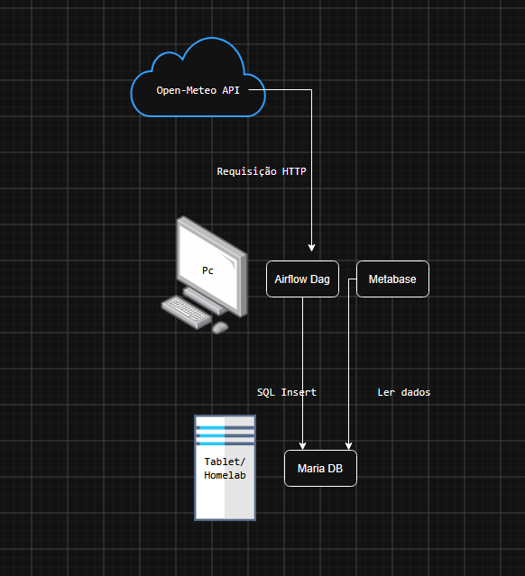
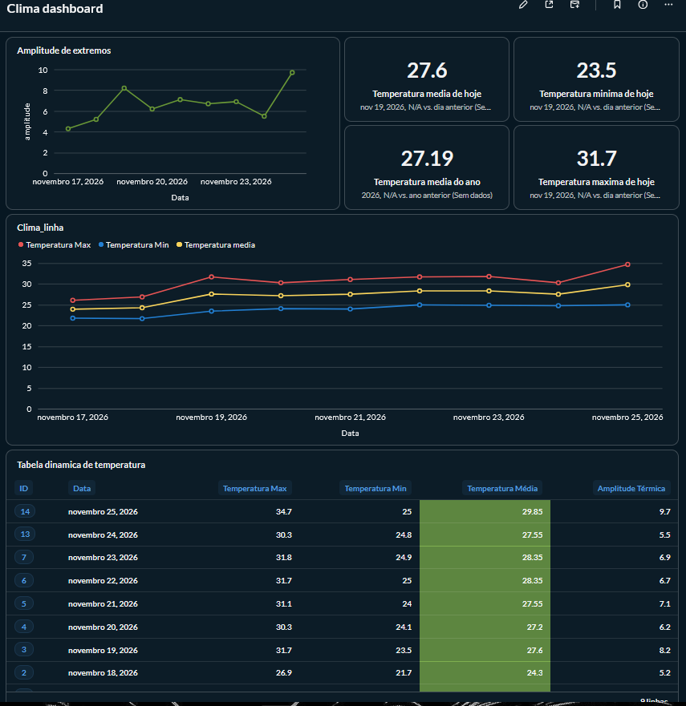
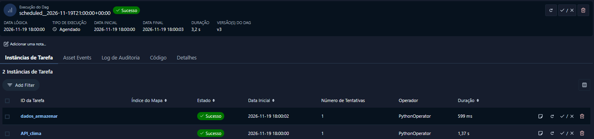
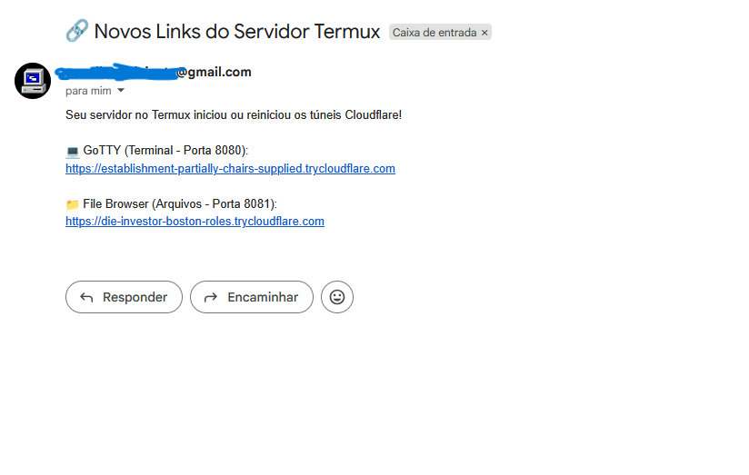

# Homelab Data Pipeline: Clima RJ

Este projeto demonstra a construção de um pipeline de dados de ponta a ponta (End-to-End) utilizando hardware reciclado (um tablet Android antigo) como servidor de banco de dados, orquestrado por Apache Airflow e visualizado no Metabase. O objetivo foi criar uma solução de baixo custo e alta disponibilidade para ingestão diária de dados meteorológicos.

## 🏗️ Arquitetura do Sistema

O fluxo de dados funciona da seguinte forma:
1. **Extração (Airflow):** Uma DAG no Apache Airflow (rodando em Docker no PC) consome a API pública Open-Meteo diariamente.
2. **Carga (Python/MySQL):** Os dados de temperatura são tratados e inseridos no banco MariaDB hospedado no tablet.
3. **Servidor (Termux):** O tablet roda o Termux com `termux-services` (runit) para gerenciar o MariaDB de forma resiliente.
4. **Visualização (Metabase):** O Metabase, também rodando em um container Docker no PC, conecta-se ao banco do tablet e gera os dashboards analíticos.

## 🛠️ Tecnologias Utilizadas
- **Android/Termux:** Servidor caseiro (MariaDB, GoTTY, termux-services).
- **Apache Airflow:** Orquestração do pipeline de dados (Docker).
- **Metabase:** Ferramenta de Business Intelligence para os dashboards (Docker).
- **Python (Pandas/Requests):** Extração e transformação dos dados da API.
- **MariaDB:** Banco de dados relacional.

## 🚀 Desafios Superados (Engenharia na prática)
- **Limitações do Android:** O Termux roda em um sandbox, exigindo o uso do `$PREFIX` e configuração de serviços via `runit` (`termux-services`) para evitar que o banco caia.
- **Autostart:** Configuração do `Termux:Boot` para garantir que os serviços subam automaticamente caso o tablet reinicie.
- **Conectividade:** Integração do IP local do tablet (`192.168.0.124`) com a DAG do Airflow e o Metabase no PC.

## 📊 Resultados e Dashboards

O pipeline está em produção, rodando diariamente via Apache Airflow. Abaixo estão as evidências do sistema em operação:

### 1. Dashboard Analítico (Metabase)
O Metabase consome os dados do MariaDB (no tablet) e gera visões de temperatura máxima, mínima e média, além de uma tabela dinâmica com o histórico recente.

### 2. Orquestração (Apache Airflow)
A DAG é executada automaticamente todos os dias. O log comprova o sucesso das tarefas de extração da API e armazenamento no banco.

### 3. Servidor e Resiliência (Termux)
Para garantir a alta disponibilidade, o script de boot do Termux gerencia o wake-lock, o banco de dados e o watchdog do túnel Cloudflare.

## 🛡️ Resiliência e Monitoramento (Watchdog Script)

Para garantir a alta disponibilidade e o acesso remoto contínuo ao servidor (Termux), foi desenvolvido um script em Python (`watchdog_tunnels.py`) que roda em background no tablet.

### O Problema
O uso do Cloudflare Quick Tunnel (gratuito) gera uma URL dinâmica a cada reinício do serviço. Se o tablet reiniciasse ou perdesse a conexão, o link antigo deixava de funcionar.

### A Solução
O script executa as seguintes etapas em um loop infinito:
1. **Limpeza:** Finaliza instâncias antigas do `cloudflared`.
2. **Inicialização:** Sobe dois túneis simultâneos (um para o GoTTY na porta 8080 e outro para o FileBrowser na porta 8081).
3. **Extração:** Utiliza Expressões Regulares (Regex) para ler os arquivos de log e capturar as novas URLs geradas pelo Cloudflare.
4. **Notificação:** Dispara um e-mail automaticamente contendo os novos links de acesso.
5. **Vigilância:** Fica em modo de espera monitorando os processos. Se os túneis caírem, o ciclo recomeça automaticamente.

## 🔒 Nota de Segurança
Para este ambiente de desenvolvimento local, o acesso ao banco foi configurado via rede interna. Para ambientes de produção, recomenda-se o uso de VPNs (como Tailscale) e usuários de banco de dados com permissões restritas (evitando o uso do `root`).